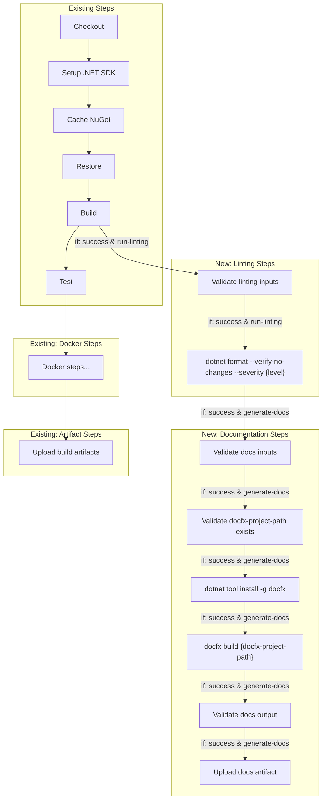
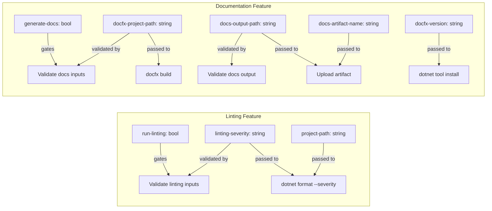

# Design Document: .NET Build — Documentation Generation & Linting

## Overview

This design extends the existing `.NET Build` reusable workflow (`dotnet-build.yml`) with two new opt-in capabilities that follow the established patterns of boolean toggle inputs, input validation steps, and conditional execution with `if: success()` guards:

1. **Documentation generation** — Installs DocFX as a .NET global tool and runs it against a caller-specified project file, uploading the output as a build artifact.
2. **Code linting** — Runs `dotnet format --verify-no-changes` with a configurable severity level to enforce code style and analyzer rules without modifying source files.

### Design Decisions

1. **DocFX as a .NET global tool** — Rather than using a container action or pre-built binary, DocFX is installed via `dotnet tool install -g docfx`. This keeps the workflow self-contained within the .NET SDK already set up by the workflow and allows version pinning through the existing NuGet ecosystem.
2. **`dotnet format` over third-party linters** — The `dotnet format` command is built into the .NET SDK and respects the project's existing `.editorconfig` and Roslyn analyzer configuration. No additional tooling installation is required.
3. **Linting before docs** — Linting runs after the build step but before documentation generation. This ensures documentation is only produced for code that passes quality checks, and leverages the existing `if: success()` guard pattern to skip downstream steps on failure.
4. **Severity as a string enum** — The `linting-severity` input accepts `info`, `warn`, or `error` and is validated with a shell conditional before being passed to `dotnet format --severity`. This matches the existing validation pattern used for Docker inputs.
5. **Separate validation steps** — Each feature has its own validation step that checks required inputs before executing the feature's main steps, consistent with the existing `Validate Docker inputs` and `Validate registry credentials` patterns.

## Architecture



### Step Ordering Within the Job

```text
1.  Checkout                          (existing)
2.  Setup .NET SDK                    (existing)
3.  Cache NuGet packages              (existing)
4.  Restore dependencies              (existing)
5.  Build                             (existing)
6.  Validate linting inputs           (NEW — if: success() && inputs.run-linting)
7.  Lint with dotnet format           (NEW — if: success() && inputs.run-linting)
8.  Test                              (existing — if: success() && inputs.run-tests)
9.  Validate docs inputs              (NEW — if: success() && inputs.generate-docs)
10. Validate docfx-project-path file  (NEW — if: success() && inputs.generate-docs)
11. Install DocFX                     (NEW — if: success() && inputs.generate-docs)
12. Generate documentation            (NEW — if: success() && inputs.generate-docs)
13. Validate docs output              (NEW — if: success() && inputs.generate-docs)
14. Upload documentation artifact     (NEW — if: success() && inputs.generate-docs)
15. Validate Docker inputs            (existing)
16. ... remaining existing steps ...
```

Linting is placed after Build (step 5) and before Test (step 8) per Requirement 7.3. Documentation generation follows after Test. Both feature blocks use `if: success()` guards so that any prior failure cascades and skips downstream steps.

## Components and Interfaces

### 1. New Workflow Inputs

| Input | Type | Required | Default | Description |
|-------|------|----------|---------|-------------|
| `generate-docs` | `boolean` | false | `false` | Enable documentation generation |
| `docfx-project-path` | `string` | false | — | Path to DocFX project file (required when `generate-docs` is true) |
| `docs-output-path` | `string` | false | `_site` | Relative path to generated docs directory |
| `docs-artifact-name` | `string` | false | `documentation` | Name for the uploaded docs artifact |
| `docfx-version` | `string` | false | `latest` | DocFX version to install |
| `run-linting` | `boolean` | false | `false` | Enable linting checks |
| `linting-severity` | `string` | false | `warn` | Severity threshold: `info`, `warn`, or `error` |

### 2. Linting Steps

```yaml
- name: Validate linting inputs
  if: success() && inputs.run-linting == true
  run: |
    SEVERITY="${{ inputs.linting-severity }}"
    if [ "$SEVERITY" != "info" ] && [ "$SEVERITY" != "warn" ] && [ "$SEVERITY" != "error" ]; then
      echo "::error::Invalid linting-severity value '$SEVERITY'. Valid values are: info, warn, error"
      exit 1
    fi

- name: Lint with dotnet format
  if: success() && inputs.run-linting == true
  run: dotnet format ${{ inputs.project-path }} --verify-no-changes --severity ${{ inputs.linting-severity }}
```

### 3. Documentation Generation Steps

```yaml
- name: Validate docs inputs
  if: success() && inputs.generate-docs == true
  run: |
    if [ -z "$(echo '${{ inputs.docfx-project-path }}' | tr -d '[:space:]')" ]; then
      echo "::error::docfx-project-path is required when generate-docs is enabled"
      exit 1
    fi

- name: Validate docfx-project-path exists
  if: success() && inputs.generate-docs == true
  run: |
    if [ ! -f "${{ inputs.docfx-project-path }}" ]; then
      echo "::error::DocFX configuration file not found at path: ${{ inputs.docfx-project-path }}"
      exit 1
    fi

- name: Install DocFX
  if: success() && inputs.generate-docs == true
  run: |
    if [ "${{ inputs.docfx-version }}" = "latest" ]; then
      dotnet tool install -g docfx
    else
      dotnet tool install -g docfx --version ${{ inputs.docfx-version }}
    fi

- name: Generate documentation
  if: success() && inputs.generate-docs == true
  run: docfx build ${{ inputs.docfx-project-path }}

- name: Validate docs output
  if: success() && inputs.generate-docs == true
  run: |
    if [ ! -d "${{ inputs.docs-output-path }}" ] || [ -z "$(ls -A '${{ inputs.docs-output-path }}')" ]; then
      echo "::error::Documentation output directory '${{ inputs.docs-output-path }}' is missing or empty"
      exit 1
    fi

- name: Upload documentation artifact
  if: success() && inputs.generate-docs == true
  uses: actions/upload-artifact@v4
  with:
    name: ${{ inputs.docs-artifact-name }}
    path: ${{ inputs.docs-output-path }}
```

### 4. Conditional Execution Pattern

All new steps follow the existing workflow pattern:

```yaml
if: success() && inputs.<toggle> == true
```

This ensures:
- Steps only run when the feature is opted in
- Steps are skipped if any prior step failed (cascading failure via `success()`)
- The `if: success()` guard on documentation steps means a linting failure automatically prevents documentation generation (Requirement 7.2)

## Data Models

This feature introduces no runtime data models or persistent state. All artifacts are GitHub Actions workflow YAML configuration that controls step execution at CI time.

**Input relationships:**



## Correctness Properties

*A property is a characteristic or behavior that should hold true across all valid executions of a system — essentially, a formal statement about what the system should do. Properties serve as the bridge between human-readable specifications and machine-verifiable correctness guarantees.*

### Why Property-Based Testing Does Not Apply

This feature produces only GitHub Actions workflow YAML configuration and shell script validation logic. There are no custom pure functions, parsers, serializers, or data transformations that would benefit from property-based testing:

- **No meaningful input space** — The workflow inputs are a small, finite set of booleans and short strings. There is no large or infinite input domain to explore with randomized generation.
- **Declarative configuration** — The feature is declarative YAML that controls CI step execution, not imperative code with input/output behavior.
- **Side-effect-only operations** — The shell scripts perform file existence checks and string comparisons, then either exit 0 or exit 1. Their behavior is fully determined by a handful of concrete conditions.
- **External service dependency** — Correctness ultimately depends on GitHub Actions runtime behavior, which cannot be unit-tested with generated inputs.

### Structural Correctness Properties (Verified via Schema/Lint Checks)

While PBT is not applicable, the following structural properties can be verified through YAML parsing and static analysis:

### Property 1: Input declaration completeness

*For any* new feature input (`generate-docs`, `docfx-project-path`, `docs-output-path`, `docs-artifact-name`, `docfx-version`, `run-linting`, `linting-severity`), the input SHALL be declared in the `workflow_call.inputs` section with the correct type and default value as specified in the requirements.

**Validates: Requirements 1.1, 2.1, 3.1, 3.2, 4.1, 5.1, 8.2**

### Property 2: Conditional guard consistency

*For any* new workflow step added by this feature, the step SHALL have an `if: success() && inputs.<toggle> == true` condition where `<toggle>` matches the feature's boolean gate (`run-linting` or `generate-docs`).

**Validates: Requirements 1.5, 4.5, 7.2**

### Property 3: Step ordering invariant

*For any* linting step and any documentation step in the workflow, the linting step SHALL appear at a lower index (earlier position) than the documentation step, and all linting steps SHALL appear after the Build step and before the Test step.

**Validates: Requirements 7.1, 7.3**

### Property 4: Validation-before-execution

*For any* feature block (linting or documentation), the first step in that block SHALL be a validation step that checks required inputs before the feature's main execution steps run.

**Validates: Requirements 2.2, 2.3, 5.3**

### Property 5: Severity enum completeness

*For any* value of `linting-severity` not in the set `{info, warn, error}`, the validation shell script SHALL exit with a non-zero code and emit an `::error::` annotation listing the valid values.

**Validates: Requirements 5.2, 5.3, 6.5**

These properties are verified through example-based tests (YAML structure inspection) and integration tests (workflow execution), as described in the Testing Strategy section.

## Error Handling

### Linting Errors

| Scenario | Behavior |
|----------|----------|
| Invalid `linting-severity` value | Validation step emits `::error::` with valid values list, exits 1 |
| `dotnet format` finds violations | Step exits non-zero, violation details visible in step log |
| `dotnet format` cannot find project | Step exits non-zero with .NET SDK error message |
| `run-linting` is `false` | All linting steps skipped via `if:` condition |

### Documentation Generation Errors

| Scenario | Behavior |
|----------|----------|
| `docfx-project-path` is empty/whitespace | Validation step emits `::error::`, exits 1 |
| `docfx-project-path` file does not exist | File validation step emits `::error::` with the path, exits 1 |
| `dotnet tool install -g docfx` fails | Step exits non-zero, install error visible in log |
| `docfx build` fails (invalid config, build errors) | Step exits non-zero, DocFX error output visible in log |
| Output directory missing or empty after successful DocFX | Output validation step emits `::error::`, exits 1 |
| `generate-docs` is `false` | All documentation steps skipped via `if:` condition |

### Cascading Failure Behavior

| Prior Failure | Effect on Linting | Effect on Docs |
|---------------|-------------------|----------------|
| Restore fails | Skipped (`success()` is false) | Skipped |
| Build fails | Skipped | Skipped |
| Linting fails | N/A | Skipped (`success()` is false) |
| Test fails | N/A | Skipped |
| DocFX install fails | N/A | Remaining doc steps skipped |

All error messages use the GitHub Actions `::error::` annotation format so they appear as annotations in the PR checks UI, consistent with the existing Docker validation steps.

## Testing Strategy

### Why No Property-Based Tests

This feature produces only GitHub Actions workflow YAML and shell script validation logic. There are no custom pure functions, parsers, serializers, or data transformations. The "input space" is a small set of workflow inputs (booleans and short strings), and all behavior is tested by running the actual workflow or inspecting the YAML structure. Property-based testing does not apply.

### Smoke Tests (YAML Structure Verification)

These verify the workflow file is correctly structured:

1. **Input declarations** — All 7 new inputs exist with correct types and defaults
2. **Step ordering** — Linting steps appear after Build and before Test; documentation steps appear after Test
3. **Conditional guards** — All new steps have `if: success() && inputs.<toggle> == true` conditions
4. **Step naming** — All new steps have descriptive `name:` fields

### Example-Based Tests (Validation Logic)

These test the shell script validation with concrete inputs:

1. **Valid severity values** — `info`, `warn`, `error` each pass validation
2. **Invalid severity value** — `warning`, `critical`, empty string each fail with correct error message
3. **DocFX version conditional** — `latest` produces command without `--version`; `2.78.2` produces command with `--version 2.78.2`
4. **Empty docfx-project-path** — Empty string and whitespace-only strings fail validation
5. **Non-existent docfx-project-path** — Path to missing file fails with correct error

### Integration Tests (Workflow Execution)

These require running the workflow in a GitHub Actions environment:

1. **Linting pass** — Run with `run-linting: true` against well-formatted code; workflow succeeds
2. **Linting fail** — Run with `run-linting: true` against code with violations; workflow fails with violations in log
3. **Docs generation pass** — Run with `generate-docs: true` and valid DocFX project; artifact is uploaded
4. **Docs generation fail (bad config)** — Run with invalid DocFX config; workflow fails
5. **Cascading failure** — Run with both enabled, linting fails; verify docs steps are skipped
6. **Independent features** — Run with `run-linting: false`, `generate-docs: true`; docs run without linting
7. **Both disabled** — Run with both `false`; no new steps execute, existing behavior unchanged
8. **Severity filtering** — Run with `linting-severity: error` against code with warnings only; workflow passes

### Verification Approach

After implementing the workflow changes:

```bash
# Validate YAML syntax
python -c "import yaml; yaml.safe_load(open('.github/workflows/dotnet-build.yml'))"

# Verify the workflow can be called with new inputs (dry-run via act or manual PR)
# Create a test caller workflow that exercises each input combination
```

The primary verification is creating a test caller workflow in a branch that invokes `dotnet-build.yml` with the new inputs and confirming correct behavior in the GitHub Actions UI.
