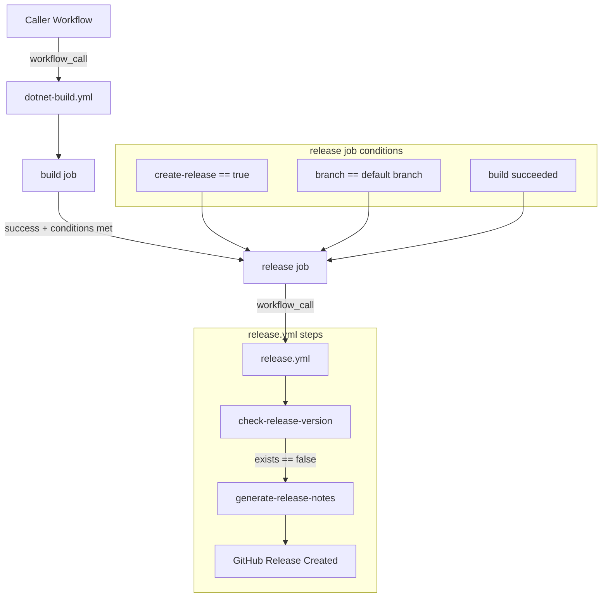
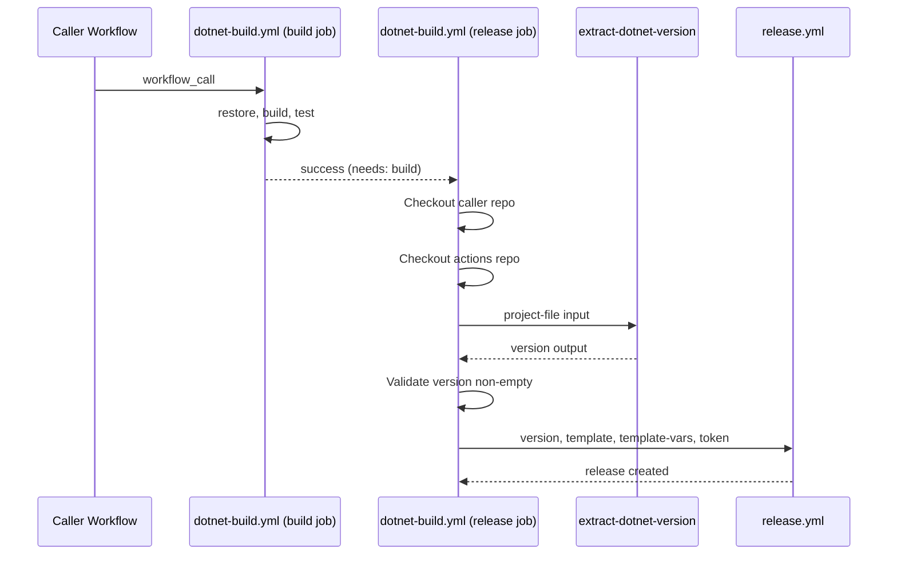

# Design Document: .NET Release Workflow

## Overview

This design extends the existing `dotnet-build.yml` reusable workflow with an optional release job that runs after a successful build on the default branch. The release job orchestrates three existing JS actions — `extract-dotnet-version`, `check-release-version`, and `generate-release-notes` — to automatically extract the project version from a `.csproj` file, verify no duplicate release exists, and create a GitHub release with templated notes.

The design reuses the existing `release.yml` reusable workflow as the underlying release mechanism, called from a new `release` job within `dotnet-build.yml`. This keeps the release logic centralized and avoids duplicating steps that are already well-tested.

### Design Goals

- **Opt-in behavior**: Release creation is off by default (`create-release: false`), so existing callers are unaffected.
- **Reuse over duplication**: Leverage the existing `release.yml` workflow and JS actions rather than reimplementing release logic.
- **Fail-fast**: Any failure in version extraction, duplicate detection, or release creation fails the job immediately with a clear error message.
- **Branch safety**: Releases only happen on the default branch, regardless of what triggers the workflow.

## Architecture



### Job Flow

1. **build job** — Existing job that restores, builds, tests, and optionally containerizes the .NET project.
2. **release job** — New job that:
   - Depends on `build` via `needs: [build]`
   - Runs only when `create-release == true` AND the ref matches the default branch
   - Checks out the caller repository to access the `.csproj` file
   - Extracts the version using `extract-dotnet-version`
   - Calls `release.yml` as a reusable workflow, passing the extracted version, template, and template vars

### Branch Detection Strategy

GitHub Actions provides `github.event.repository.default_branch` in the context of `workflow_call` events. The release job uses a conditional that compares `github.ref` against `refs/heads/<default_branch>` to determine if the current run is on the default branch.

```yaml
if: >-
  inputs.create-release == true &&
  github.ref == format('refs/heads/{0}', github.event.repository.default_branch)
```

## Components and Interfaces

### New Workflow Inputs (dotnet-build.yml)

| Input | Type | Required | Default | Description |
|-------|------|----------|---------|-------------|
| `create-release` | boolean | false | `false` | Opt-in flag to enable release creation |
| `version-source-project` | string | false | `''` | Path to `.csproj` for version extraction; defaults to `project-path` if empty |
| `release-notes-template` | string | false | `''` | Handlebars template string for release notes |
| `release-template-vars` | string | false | `'{}'` | JSON object of key-value pairs for template substitution |

### New Workflow Secrets (dotnet-build.yml)

| Secret | Required | Description |
|--------|----------|-------------|
| `release-token` | false | Optional PAT for release creation; falls back to `github.token` |

### New Job Outputs (release job)

| Output | Description |
|--------|-------------|
| `release-url` | URL of the created GitHub release (empty if release was skipped) |

### Interaction with Existing Actions

The release job does **not** call the JS actions directly. Instead, it delegates to the existing `release.yml` reusable workflow, which already orchestrates `check-release-version` and `generate-release-notes`. The only direct action call in the release job is `extract-dotnet-version` to resolve the version before passing it to `release.yml`.



**Note on architecture**: GitHub Actions does not support calling a reusable workflow (`workflow_call`) from within a job step — reusable workflows can only be invoked as entire jobs. Therefore, the release job will directly inline the release steps (checkout actions repo, check-release-version, generate-release-notes) rather than calling `release.yml`. This mirrors the pattern already established in `release.yml` but within the `dotnet-build.yml` context.

### Revised Release Job Structure

Since reusable workflows cannot be called from job steps, the release job will:

1. Checkout the caller repository (for `.csproj` access)
2. Checkout the `LDK-Systems/actions` repository (for local action access)
3. Run `extract-dotnet-version` to get the version
4. Validate the version is non-empty
5. Run `check-release-version` to verify no duplicate
6. Fail if version already exists
7. Run `generate-release-notes` to create the release

This is the same step sequence as `release.yml` but with the version extraction prepended.

## Data Models

### Workflow Input Schema

```yaml
# New inputs added to dotnet-build.yml workflow_call
inputs:
  create-release:
    required: false
    type: boolean
    default: false
    description: 'Create a GitHub release after successful build on default branch'
  version-source-project:
    required: false
    type: string
    default: ''
    description: 'Path to .csproj file for version extraction (defaults to project-path)'
  release-notes-template:
    required: false
    type: string
    default: ''
    description: 'Handlebars template string for release notes body'
  release-template-vars:
    required: false
    type: string
    default: '{}'
    description: 'JSON string of key-value pairs for template substitution'
```

### Version Resolution Logic

```
version-source-project input → if empty → use project-path input
                             → if non-empty → use as-is
                             
extract-dotnet-version output → version string
                              → if empty → fail with error
                              → if non-empty → pass to check-release-version
```

### Token Resolution

```
secrets.release-token → if provided → use as token
                      → if not provided → use github.token
```

### Action I/O Mapping

| Step | Action | Inputs | Outputs Used |
|------|--------|--------|--------------|
| Extract version | `extract-dotnet-version` | `project-file: <resolved-project-path>` | `version` |
| Check version | `check-release-version` | `version`, `repository: github.repository`, `token` | `exists` |
| Generate notes | `generate-release-notes` | `template`, `template-vars`, `version`, `repository`, `token` | `release-url` |

## Correctness Properties

*A property is a characteristic or behavior that should hold true across all valid executions of a system — essentially, a formal statement about what the system should do. Properties serve as the bridge between human-readable specifications and machine-verifiable correctness guarantees.*

> **Note:** This feature is primarily workflow YAML configuration orchestrating existing, already-tested JS actions. Traditional property-based testing (generating random inputs across 100+ iterations) does not apply to declarative workflow configuration. The properties below are stated as formal invariants that must hold across all workflow executions and are validated through integration tests and workflow linting rather than PBT.

### Property 1: Release job gate is a strict conjunction

*For any* workflow execution, the release job SHALL execute if and only if all three conditions hold simultaneously: `create-release == true`, the triggering ref matches the repository's default branch, and the build job completed with success status. If any single condition is false, the release job is skipped entirely.

**Validates: Requirements 1.1, 1.2, 1.3, 6.1, 6.2**

### Property 2: Version is always validated before use

*For any* release job execution, the extracted version string SHALL be validated as non-empty before it is passed to any downstream action (check-release-version or generate-release-notes). No downstream action ever receives an empty version string.

**Validates: Requirements 2.3, 2.4, 2.5**

### Property 3: Duplicate release prevention precedes creation

*For any* release job execution where a valid version has been extracted, the check-release-version action SHALL execute and confirm the version does not already exist before generate-release-notes is invoked. A release is never created without first verifying uniqueness.

**Validates: Requirements 3.1, 3.2, 3.3**

### Property 4: Token resolution produces exactly one credential

*For any* workflow execution where the release job runs, the resolved token SHALL be exactly one of: the caller-provided `token` secret (if supplied) or `github.token` (if not supplied). The same resolved token SHALL be passed to both check-release-version and generate-release-notes — never different tokens to different actions.

**Validates: Requirements 5.2, 5.3, 5.4**

### Property 5: Step failure halts subsequent steps

*For any* release job execution, if any step fails (checkout, extract-dotnet-version, version validation, check-release-version, or generate-release-notes), all subsequent steps SHALL be skipped and the job SHALL report failure. No step executes after a preceding step has failed.

**Validates: Requirements 2.4, 3.4, 4.6, 6.4**

### Property 6: Version source resolution fallback

*For any* workflow execution where `version-source-project` is empty or not provided, the release job SHALL use the `project-path` input value as the project file path for version extraction. When `version-source-project` is non-empty, it SHALL be used as-is without fallback.

**Validates: Requirements 2.1, 2.2**

## Error Handling

### Failure Modes and Messages

| Failure Condition | Error Message | Source |
|-------------------|---------------|--------|
| Version extraction fails (file not found) | `File not found: <path>` | `extract-dotnet-version` action |
| Version extraction fails (invalid XML) | `File is not valid XML: <path>` | `extract-dotnet-version` action |
| Version extraction fails (no version elements) | `No version information found in <path>` | `extract-dotnet-version` action |
| Extracted version is empty string | `No usable version found in <path>` | Release job inline step |
| Version already exists as release | `Version <version> already exists in <repository>` | Release job inline step |
| Repository format invalid | `Input "repository" must be in owner/repo format...` | `check-release-version` action |
| Template vars not valid JSON | `Input "template-vars" is not valid JSON` | `generate-release-notes` action |
| Template vars not a JSON object | `Input "template-vars" must be a JSON object` | `generate-release-notes` action |
| Token lacks permissions | `Resource not accessible by integration` | GitHub API (403) |
| Actions repo checkout fails | Standard `actions/checkout` failure | GitHub Actions |

### Error Propagation Strategy

- Each action uses `core.setFailed()` to report errors, which sets the step's outcome to `failure`.
- The release job uses `if: success()` conditions (implicit default) so any failed step stops subsequent steps.
- The `runAction` wrapper in `@ldk-systems/lib` catches unhandled exceptions and routes them through `core.setFailed()`.
- The empty-version check is an explicit inline shell step that calls `exit 1` with a descriptive `::error::` annotation.

### Graceful Degradation

- When `create-release` is `false` (default), the release job is entirely skipped — no checkout, no action execution.
- When the branch is not the default branch, the release job is skipped even if `create-release` is `true`.
- The build job is completely unaffected by the release job's existence or failure.

## Testing Strategy

### Why Property-Based Testing Does Not Apply

This feature is primarily **workflow YAML configuration** that orchestrates existing, already-tested JS actions. The new code consists of:

1. GitHub Actions workflow YAML (declarative configuration)
2. Inline shell steps for validation (simple conditionals)
3. Workflow input/secret declarations

The underlying JS actions (`extract-dotnet-version`, `check-release-version`, `generate-release-notes`) already have comprehensive property-based tests covering:
- Version string validation (Property 5 in `check-release-version`)
- Repository format validation (Property 5 in `check-release-version`)
- Template rendering with unmatched placeholders (`packages/lib` template tests)
- XML parsing round-trips (`packages/lib` XML property tests)

Since the new work is declarative workflow configuration — not functions with inputs/outputs — property-based testing is not appropriate. Workflow YAML is best validated through integration testing and manual verification.

### Testing Approach

**Integration Tests (Primary)**:
- Create a test caller workflow that invokes `dotnet-build.yml` with `create-release: true`
- Verify the release job is skipped on non-default branches
- Verify the release job executes on the default branch after a successful build
- Verify end-to-end release creation with a test `.csproj` file

**Manual Verification**:
- Validate workflow YAML syntax with `actionlint` or GitHub's workflow editor
- Verify conditional expressions evaluate correctly by inspecting workflow run logs
- Confirm job dependency ordering in the Actions UI

**Existing Unit/Property Tests (Already Covered)**:
- `check-release-version/__tests__/validation.property.test.ts` — validates version and repo format inputs
- `check-release-version/__tests__/index.test.ts` — validates action behavior
- `extract-dotnet-version/__tests__/index.property.test.ts` — validates version extraction
- `packages/lib/__tests__/template.property.test.ts` — validates template rendering
- `packages/lib/__tests__/xml.property.test.ts` — validates XML parsing

**Workflow Linting**:
- Run `actionlint` against the modified `dotnet-build.yml` to catch syntax errors, type mismatches, and invalid expressions before merging.

### Test Scenarios

| Scenario | Expected Outcome |
|----------|-----------------|
| `create-release: false` (default) | Release job skipped |
| `create-release: true`, non-default branch | Release job skipped |
| `create-release: true`, default branch, build fails | Release job not executed |
| `create-release: true`, default branch, build succeeds, version exists | Release job fails with duplicate error |
| `create-release: true`, default branch, build succeeds, new version | Release created successfully |
| `version-source-project` empty | Falls back to `project-path` |
| `version-source-project` specified | Uses specified path |
| Extracted version is empty string | Release job fails with descriptive error |
| Invalid `release-template-vars` JSON | `generate-release-notes` fails with JSON error |
| Template with unmatched placeholders | Placeholders preserved in output |
